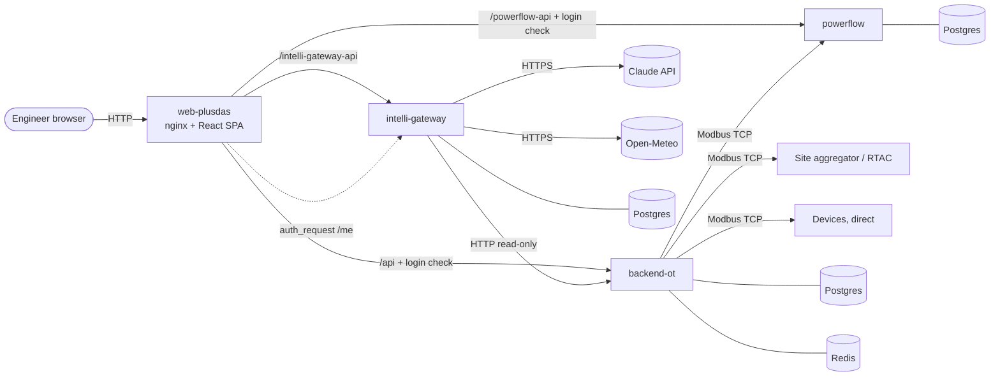
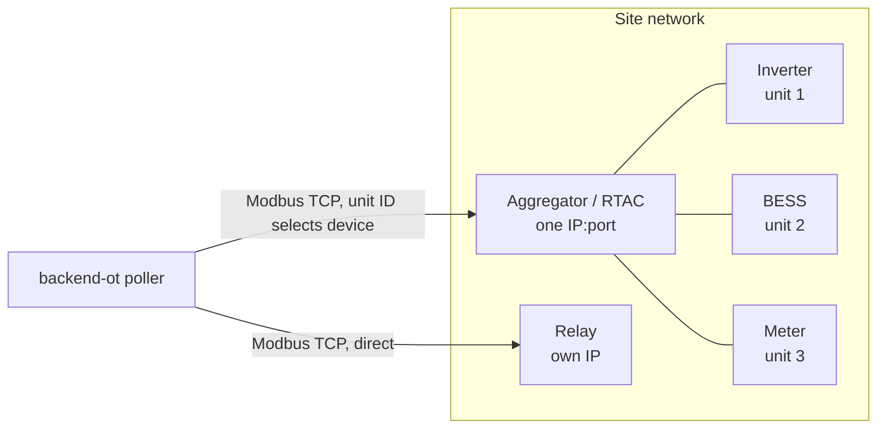
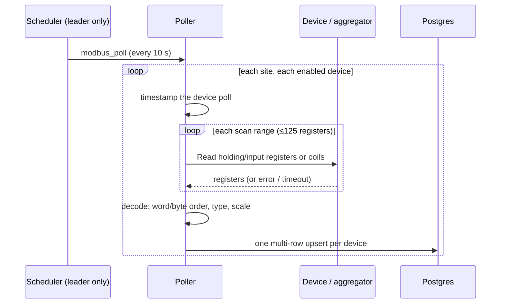
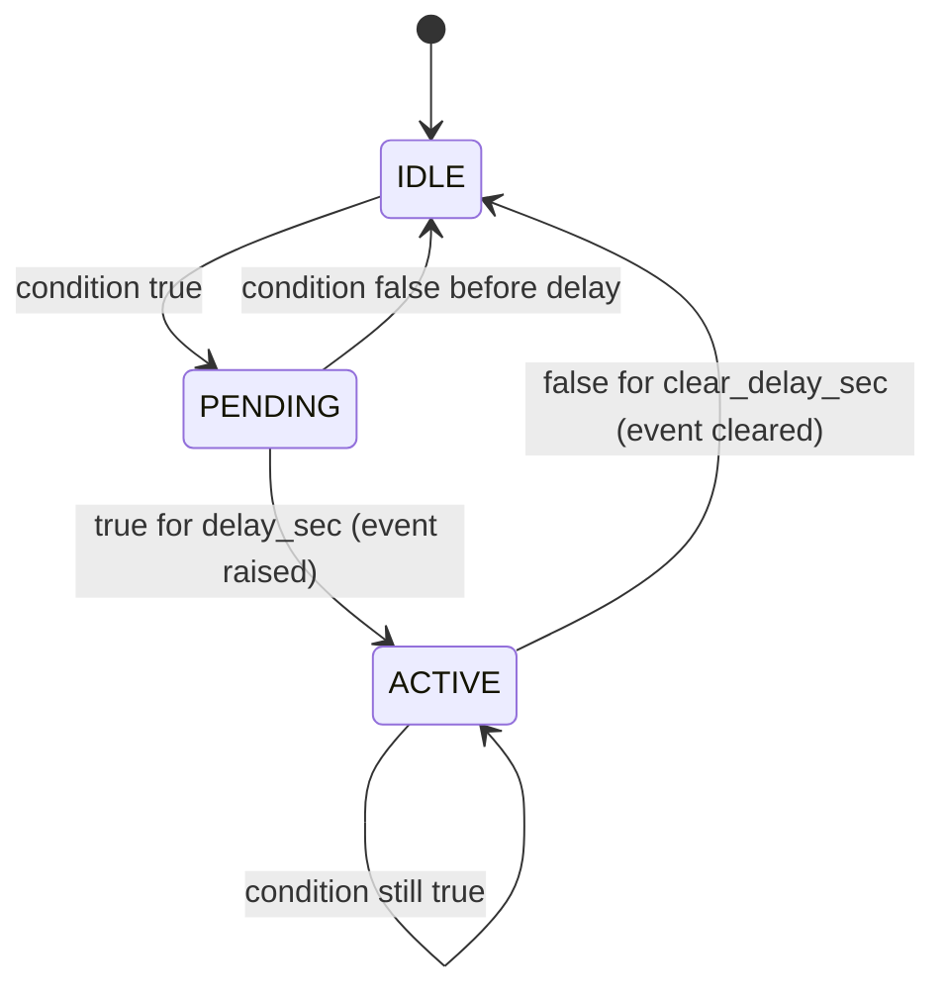
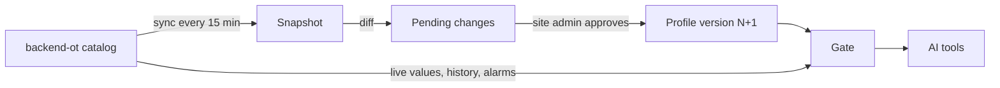
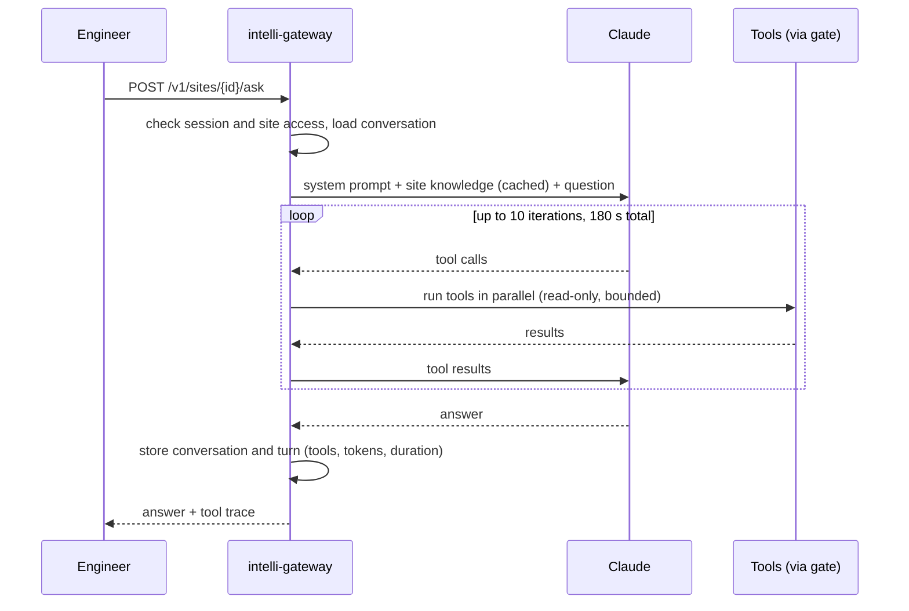
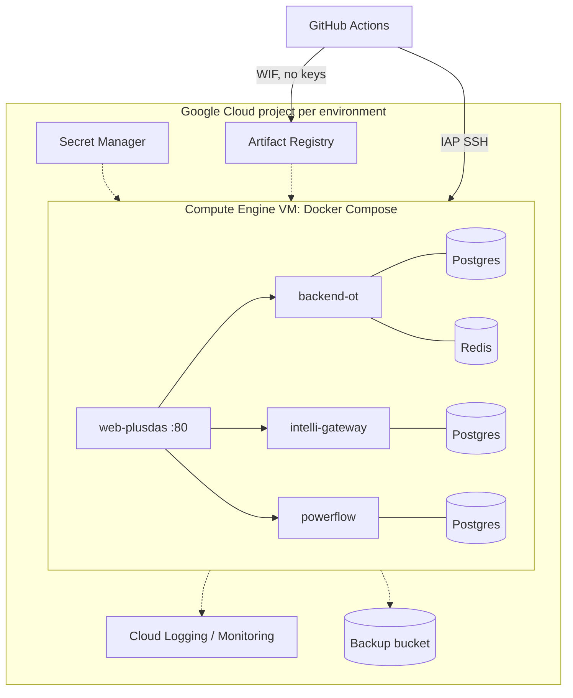

# PlusDAS Platform: System Design

**Audience:** technical stakeholders (controls, SCADA, software and IT engineers).
**Scope:** how the platform acquires data from site devices, stores and evaluates it, serves it to
users, and how its AI assistant, simulator and deployment work. Items not yet built are marked
**Roadmap**.

---

## 1. Overview

PlusDAS is a data acquisition, historian and engineering platform for renewable and storage sites
(PV, BESS, meters, relays, gensets). It is built as a set of **independent services** that talk only
over the network and share only machine-readable **contracts** (OpenAPI specs and Modbus register
maps).

| Service | Responsibility | Technology | Data store |
|---|---|---|---|
| **backend-ot** | Modbus acquisition, historian, alarms, site calculations, reports | Python, FastAPI, APScheduler, pymodbus | PostgreSQL 16, Redis 7 |
| **intelli-gateway** | Users and login, AI assistant (Claude), AI access gate, engineering knowledge, PV forecast | Python, FastAPI, Anthropic SDK, pvlib | PostgreSQL 16 (own) |
| **web-plusdas** | Web UI and the single entry point (reverse proxy, login check) | React 18, TypeScript, Vite, TanStack Query, nginx | none |
| **powerflow** | Microgrid power-flow simulator that behaves like a real site over Modbus | Python, FastAPI, pandapower | PostgreSQL 16 (own) |
| **mobile-plusdas** | Phone app (iOS / Android) | Expo, React Native | on-device settings |



**Design principles**
- **Service isolation.** No service imports another's code or reads its files. Every service builds,
  tests and deploys on its own, with its own database.
- **Contract-first integration.** Each provider generates its contract from code (OpenAPI 3.1, register
  maps). Consumers generate typed clients from it. CI fails if a contract is stale or a breaking change
  isn't versioned.
- **Single origin.** The browser talks to one host. nginx routes `/api`, `/powerflow-api` and
  `/intelli-gateway-api` to the services, so there is no CORS and no service is exposed directly.
- **Read-only AI.** The assistant can read approved data and run approved calculations. It cannot
  write to the plant.

---

## 2. Data acquisition (backend-ot)

### 2.1 Configuration model

```
sites ──< devices ──< device_points
```

- **Site:** name, time zone, location, capacity, optional *site profile* (site-specific code; §4).
- **Device:** type (`BESS, ES, INVERTER, PV, GENERATOR, LOADBANK, RELAY, IED, METER, RTAC`) plus
  connection settings:
  - `read_from_aggregator`: read through the site aggregator, or directly from the device
  - `host`, `port`: used for direct reads
  - `server_address`: the Modbus unit ID
  - `modbus_address_mode`: zero- or one-based register numbering
  - `poll_enabled`, `scan_ranges` (computed or locked by the engineer)
- **Point** (the register map *is* the point table):

| Field | Purpose |
|---|---|
| `address`, `size`, `poll_kind` | Register location; holding, input or coil |
| `data_type` | `int16/uint16/int32/uint32/int64/uint64`, `float32/float64`, `bool`, `enum16/32`, `bitfield16/32`, `status_word16/32`, `raw` |
| `byte_order`, `word_order` | Endianness and 32/64-bit word swap |
| `scale_factor`, `unit` | Engineering conversion |
| `enum_detail`, `bitfield_detail` | Value and bit labels |
| `class` | `ANALOG`, `BINARY`, `ALARM`, `CONTROL` |
| `severity` | `HIGH`, `MEDIUM`, `LOW` (alarm-class points) |
| `category` | `NATIVE` (read from registers), `STANDARDIZED`, `VIRTUAL` |
| `record_enabled` | Store in the historian, or read only |

- **Standardized points** give every device of a type the same names (for example
  `BESS_ACTIVE_POWER`, `BESS_STATE_OF_CHARGE`). Each links to the vendor's native point, so analytics
  and the UI work the same across vendors.
- **Virtual points** are either user formulas computed on read, or site-profile points computed by a
  background job and stored.
- Register maps can be imported and exported as CSV, with a dry-run validation step first.

### 2.2 Aggregator vs direct reads



- **Through the aggregator** (the default): every device on the site is read through one aggregator
  endpoint (for example an SEL RTAC or a data concentrator). The Modbus **unit ID** selects the device.
- **Direct:** the device's own `host:port` is used. The simulator sites work this way.
- Both modes can be mixed on one site, device by device.

### 2.3 Poll cycle



- **Scan ranges:** points are grouped by register type, sorted by address and merged into blocks. A
  new block starts when the gap exceeds 10 registers or the block would exceed 125 registers (the
  Modbus limit). Ranges are recomputed when points change, unless an engineer locks them.
- **Decoding:** word order (MSW/LSW first), byte order, type conversion, then `value × scale`. Enum
  and bitfield values are stored as integers; their labels are applied when the data is read and
  when alarms are evaluated.
- **Fault tolerance:**
  - Each read has a 5 s timeout and 3 retries.
  - A failed range doesn't stop the others. Its points get a NULL reading for that cycle.
  - A device with no valid value in a cycle stores nothing for that cycle.
  - Communication health is derived from the last successful reading per device. A gap of more than
    3 poll intervals counts as missing data.
- **Single poller:** the scheduler runs inside the API process. A Redis leader lock
  (`SET NX`, 30 s expiry, renewed every 10 s) makes sure only one instance polls, even if several run.
  APScheduler doesn't overlap runs of the same job.
- **Diagnostics:** engineers can read raw registers once, or stream them live to the browser
  (server-sent events) at a chosen interval, to commission and debug register maps.

### 2.4 Historian storage

- **Table:** `device_points_readings (timestamp, site_id, device_id, device_point_id, raw_value,
  derived_value)`
  - Primary key `(timestamp, device_point_id)`
  - Index `(site_id, device_id, timestamp DESC)` for per-device time-range queries
- **Write path:** one multi-row `INSERT … ON CONFLICT DO UPDATE` per device per cycle (idempotent).
  If the batch fails, rows are written one by one.
- **Volume:** a point polled every 10 s gives about 8,640 rows a day. A 415-point site produces about
  73,000 rows an hour.
- **Reads:**
  - Long time windows are downsampled in SQL (first, last, min and max per time bucket), so a chart
    always gets a bounded number of points.
  - Series from different devices are aligned with a 1 s tolerance, carrying the last value forward for
    up to 30 s.
- **Retention:** site data is kept indefinitely.
- **Schema management:** numbered SQL migrations, applied once per deployment by a dedicated migration
  step before the application starts.
- **Redis** holds only coordination state: the leader lock, job locks and live-stream session
  snapshots. All measured data lives in PostgreSQL.

### 2.5 Main backend-ot tables

| Area | Tables |
|---|---|
| Configuration | `sites`, `devices`, `device_points` (soft delete with restore) |
| Historian | `device_points_readings` |
| Alarms | `alarm_definitions`, `alarm_events`, `alarm_evaluation_state` |
| Single-line diagram | `site_slds` (JSON diagram plus a revision number for safe concurrent edits) |
| PV configuration | `pv_array_configs` (tilt, azimuth, DC/AC kW, losses) |
| Site profiles | `profile_point_state` (how far each computed point has been calculated) |
| Reports | `report_templates`, `report_runs`, `report_schedules` |

---

## 3. Background jobs

### backend-ot

All jobs run on the leader instance only, on interval triggers.

| Job | Every | What it does |
|---|---|---|
| `modbus_poll` | 10 s | Polls every enabled device and stores the readings |
| `alarm_evaluation` | 22 s | Evaluates every enabled alarm rule from the stored data |
| `profile_point_compute` | 10 s | Computes site-profile virtual points up to *now − 10 s*; catches up after downtime |
| `report_worker` | 5 s | Generates up to 5 queued report runs; fails runs stuck for more than 15 min |
| `report_schedule_dispatch` | 60 s | Queues scheduled reports (in the site's time zone) and prunes old runs |

At startup, before the scheduler starts, the service syncs each site profile's alarm rules and
computed points from code into the database.

### intelli-gateway

| Job | Every | What it does |
|---|---|---|
| `site-profile-sync` | 15 min | Reads every site's catalog from backend-ot and lists what changed (approves nothing) |
| `forecast-refresh` | 15 min | Fetches weather, computes the 72 h PV forecast per site, prunes runs older than 7 days |

Both run at startup and retry after 30 s on failure.

### powerflow

A real-time simulation loop steps the network every second (up to 100× faster than real time).

---

## 4. Site profiles and calculations (backend-ot)

A **site profile** is site-specific code attached to one site. It declares four things:

| Declaration | What it is |
|---|---|
| **Site functions** | Calculations exposed as API endpoints, site-wide or per device |
| **Profile alarms** | Alarm logic written in code (in addition to engineer-defined rules) |
| **Device health checks** | Status boxes on the single-line diagram |
| **Computed points** | Values calculated by a background job and stored like measurements |

- **Who may use each function:** every function is labelled `user_visible` (historian, reports),
  `ai_assistant` (the AI may call it once a site admin approves it), or both.
- **Point access:** functions read points by device and point name, with sign conventions normalised
  (export is positive).
- **Example: BESS round-trip efficiency, corrected for state-of-charge change.**
  - E_dis = ∫max(P,0)dt and E_ch = ∫max(−P,0)dt
  - ΔS = ΔSoC × usable energy
  - Assuming symmetric losses, solve E_ch·x² − ΔS·x − E_dis = 0, then η_RT = x²
  - With no SoC change this reduces to E_dis / E_ch.
  - A rolling variant gives the efficiency over a configurable lookback, hour by hour.
- **Other functions:** POI and asset active/reactive power, energy summaries, inverter availability,
  voltage, current and power imbalance.

---

## 5. Alarm system



- **Rule types**
  - **User rules,** built in the UI:
    - `threshold`: a point against a value or another point, with a deadband, or a bit test
    - `condition`: ALL / ANY groups of comparisons
    - `comms_stale`: no data from a device for N seconds
  - **Profile alarms:** logic written in the site profile. Engineers can enable or disable them and set
    notification flags.
  - Severity is `HIGH`, `MEDIUM` or `LOW`. A site can have up to 20 enabled rules.
- **Evaluation**
  - A pure state machine with raise and clear delays prevents chattering.
  - **Missing or stale data never raises or clears an alarm.** Loss of communication is its own
    explicit alarm type.
  - Each site is evaluated in one database transaction. Editing or disabling a rule clears its active
    event.
- **Storage:** every raise and clear is a row in `alarm_events`. A partial unique index allows at
  most one active event per rule.
- **Alarm-class points:** fault words and fault codes from devices are decoded on request (active
  bits and labels) for the alarms page, device health and the AI assistant.
- **UI:** follows ISA-101 / ISA-18.2 practice. Grey means normal, and severity is shown as colour, icon
  and word together. The page refreshes every 10 s.
- **Roadmap:** e-mail and mobile push notifications (the per-rule notification flags already exist).

---

## 6. Reports

- **Templates** are built per site in the UI.
- **Runs** are queued and generated by a background worker. Each run's result is stored as a
  **snapshot**, so a report always shows the data it was generated from.
- **Schedules** follow the site's time zone, and each schedule keeps a set number of runs or days.
- **Export:** PDF through the browser's print view, plus CSV and JSON.

---

## 7. intelli-gateway: users, AI assistant and forecasts

### 7.1 Users and sessions

- **Accounts:** sign in by e-mail. Roles are `admin`, `engineer` and `monitor`. Admins create
  accounts; there is no self-signup.
- **Passwords:** scrypt (N=2¹⁴, r=8, p=1) with a per-user salt. Minimum 10 characters.
- **Sessions:**
  - The token is 256 bits of randomness. Only its SHA-256 hash is stored.
  - It is sent in an `HttpOnly`, `SameSite=Lax` cookie with a 30-day sliding expiry.
  - Disabling a user or resetting their password ends all of their sessions.
- **Login check at the edge:** nginx calls the gateway's `/api/v1/me` (`auth_request`) before
  forwarding any `/api` or `/powerflow-api` request.
  - A confirmed session is cached for 60 s.
  - If the gateway is briefly unavailable, sessions confirmed in the last hour still pass, so a gateway
    restart doesn't log users out.
- **Per-user data:** preferences, saved historian trends and notes.
- **Roadmap:** HTTPS with secure cookies, login rate limiting, SSO/OIDC, per-site access grants.

### 7.2 The AI access gate (site profiles for the AI)

The AI never sees backend-ot directly. It sees an **approved profile** of each site.



- **What a profile holds:** site facts, devices, points, topology and approved site functions.
  Network and Modbus details (hosts, ports, addresses) are never copied into it.
- **Sync** reads backend-ot and computes the differences: device added/removed/renamed, point
  definition changed, function added. **It never changes what the AI sees.**
- **Approval** turns all changes, or selected ones, into a new profile version. Versions are kept for
  audit. If backend-ot changed since the admin reviewed, the approval is refused.
- **The gate** answers device, point and topology questions from the approved profile. Live data is
  read from backend-ot and filtered down to approved devices and points.
  - A value whose definition changed in backend-ot but isn't approved yet is flagged
    `definition_pending_review`.
  - Functions run only if approved, only on approved devices of the right type, and only with their
    declared parameters.

### 7.3 Engineering knowledge

Site admins write knowledge in a **draft**, then publish the whole site as a new **version**. The AI
reads only the published version. Older versions can be restored.

| Item | Content |
|---|---|
| **Site prompts** | Named texts (overview, how the site runs, how to answer), linked to points, functions, documents and devices |
| **Point guides** | Per device point: meaning, normal range, limits, and per enum value, bit or vendor fault code: severity, message, probable causes, checks, safety note |
| **Documents** | Manuals, IM scripts, procedures, engineers' experience notes |
| **Device facts** | Ratings (energy capacity, rated power, warranted efficiency…) and notes |

- **Validation on every edit:**
  - Knowledge may refer only to approved devices and points.
  - Text that looks like a secret (passwords, keys, IP addresses) is refused.
  - Stale edits are rejected through revision numbers.
- **Coverage report:** alarm and status points that have no guide yet, and devices with no ratings.
  This is the onboarding to-do list.

### 7.4 The assistant



- **Model:** Claude Opus 5.5 with adaptive thinking.
- **Prompt caching:** the system prompt and the whole published site knowledge form a cached
  prefix. The current time and the site's local date go in the user turn, so the cache stays valid.
- **Tools** (all read-only; the site always comes from the request context, never from the model):

| Tool | Purpose |
|---|---|
| `get_site_overview` | Devices, comms status, topology, active alarm count |
| `list_points`, `get_point_values`, `get_point_history` | Catalog search, live values with labels and staleness, history summaries and state changes |
| `get_device_status` | Everything about one device right now, with applicable guide entries |
| `get_active_alarms`, `get_alarm_history` | Alarm events and active fault words or codes |
| `explain_point`, `lookup_fault` | Engineer guides: meaning, causes, checks, safety notes |
| `get_device_script`, `search_experience_notes` | IM scripts and past incidents |
| `list_site_functions`, `run_site_function` | Approved backend-ot calculations (window ≤ 31 days; series ≤ 6 h at 15-min resolution) |
| `get_pv_forecast` | PV power and weather forecast |

- **Output bounds:**
  - Tool results are capped at 20,000 characters, 50 rows and 20 points per call. A larger result is
    replaced by a truncated preview and a hint.
  - Errors come back to the model as results, with a hint, so it can recover.
- **Audit:** every turn stores the question, answer, model, tool calls (name, arguments, duration,
  error), token counts and the user's feedback (thumbs up/down with a comment).
- **Integration seam:** tools sit behind a provider interface that mirrors MCP's `list_tools` /
  `call_tool`, so an MCP server can be added without changing the agent loop.
- **Roadmap:** streamed answers, knowledge search for very large sites, cost budgets, and
  write/action tools with human approval.

### 7.5 PV forecast

- **Weather:** Open-Meteo at 15-minute resolution, including plane-of-array irradiance for each
  distinct tilt and azimuth. The weather source is replaceable, with ordered fallbacks.
- **PV model** (PVWatts-style, using pvlib):
  1. Solar position at each interval
  2. Plane-of-array irradiance (from the provider, or Hay-Davies transposition)
  3. Cell temperature (SAPM model)
  4. DC = kW_dc × POA/1000 × (1 + γ(T_cell − 25))
  5. AC = DC × (1 − losses), clipped at AC capacity
- **Array configuration** (tilt, azimuth, DC/AC kW, losses) comes from backend-ot, per PV device.
- **Storage:**
  - `forecast_runs`, and `forecast_intervals` per site and per array
  - Each refresh supersedes earlier values for the same intervals.
  - `forecast_fetch_log` records every fetch attempt and backs a health endpoint.
- **Shown in:** the historian next to measured PV power, and the AI's `get_pv_forecast` tool.

### 7.6 Gateway database

| Area | Tables |
|---|---|
| Users | `users`, `user_sessions`, `user_preferences`, `user_saved_trends`, `user_notes` |
| AI gate | `site_catalog_snapshots`, `site_profile_versions` |
| Knowledge | `site_knowledge_drafts`, `site_knowledge_versions` |
| Assistant | `ai_conversations`, `ai_turns` |
| Forecast | `forecast_runs`, `forecast_intervals`, `forecast_fetch_log` |

Migrations are numbered SQL files, applied at startup under a Postgres advisory lock.

---

## 8. web-plusdas (UI and edge)

- **SPA:**
  - React 18 and TypeScript, with TanStack Query for data fetching and caching.
  - Recharts for the historian. A custom SVG renderer and editor for single-line diagrams.
- **Typed API clients** are generated from each service's OpenAPI contract. A contract change that
  breaks the UI fails the type check in CI.
- **Pages:**
  - Sites and devices (point grid, CSV import/export)
  - Live data (register snapshots and streams)
  - Historian (measurements, site functions, PV forecast)
  - Alarms, single-line diagram, reports
  - Simulation, AI assistant, notes, users, settings
  - AI site profiles and knowledge admin
- **Refresh model:**

| View | Refresh |
|---|---|
| SLD live values, alarms, active-alarm badge | every 10 s |
| Report status while a run is pending | every 2 s |
| Simulation status | every 2 s |
| Historian | on demand, or 60 s auto-refresh if the user turns it on |
| Register live stream | server-sent events |

- **nginx:**
  - Reverse proxy and login check for the three services.
  - Unbuffered streaming for live data.
  - Immutable caching for static assets.
  - Upstreams are resolved per request, so the UI stays up even when a backend restarts.
- **Runtime configuration:** settings are written to `/config.js` at container start, so one image
  serves every environment.

---

## 9. powerflow (site simulator)

powerflow lets the platform, and a future EMS, be developed and tested against a realistic site
without field hardware.

- **Network model:**
  - Utility source with short-circuit impedance → POI → MV collector buses → step-up transformers →
    BESS and PV inverters, plus site loads.
  - Solved as a balanced steady-state power flow (Newton-Raphson, pandapower).
- **Asset models:**
  - BESS: mode, P/S limits, ramp rates, state of charge, efficiency, auxiliary load
  - PV: availability profile, clipping, curtailment, power factor / Q control
  - Load: load profile with noise
- **Loop:** each step applies the asset limits, solves the network and publishes a snapshot (1 s steps,
  up to 100×).
  - Deterministic for a given configuration, seed and setpoint sequence.
  - If the solver doesn't converge, the last good state is kept and flagged.
- **Interfaces:**
  - **HTTP:** setpoints in (clamped to limits; the response says what was accepted and why);
    measurements out.
  - **Simulation control:** start, pause, step, speed.
  - **Event scenarios:** breaker trips, faults, comm loss, grid voltage and frequency events.
  - **Modbus TCP server:** an aggregator with a standard register map (100 registers per device). The
    map is published as a contract.
- **Integration with backend-ot:** backend-ot polls the simulator **exactly as it polls a real site**.
  An end-to-end check compares backend-ot's stored values with the simulator's own values (all 9
  devices of the 2-BESS / 1-PV reference site agree).
- **Storage:** sites and scenarios in its own PostgreSQL; profiles as CSV files.
- **Roadmap:** setpoints over Modbus, DNP3, dynamic frequency model.

---

## 10. Deployment and operations



- **Environments:**
  - **local:** the full stack on a laptop, with simulated sites
  - **dev:** a cloud copy of production with non-client data; gets every merge automatically
  - **prod:** real sites; gets the same build only after the owner approves it
- **Runtime:** one VM per environment running Docker Compose.
  - Each service has its own container, memory limit and health check.
  - Databases live on a separate persistent data disk.
  - Only the web container exposes a port.
- **Images:** built once per commit by CI, smoke-tested, published with SBOM and provenance, and
  tagged with the git SHA. Every environment runs the same immutable images.
- **CI** on every pull request:
  - Lint, type check and tests for each changed service and every consumer of a changed contract
  - Service-boundary check and contract freshness check
  - Image build and smoke test
- **CD:** deploying a release
  1. Writes each service's configuration from Secret Manager
  2. Takes a pre-deploy database dump
  3. Runs migrations
  4. Starts the containers and waits until they are healthy
  5. Checks health through the UI origin
  6. **Rolls back automatically** to the previous release on failure
- **Security:**
  - No long-lived credentials: GitHub reaches the cloud through Workload Identity Federation.
  - Admin access is through IAP with OS Login; the production VM has no public IP.
  - Secrets live only in Secret Manager and root-only files on the VM.
- **Backups:** daily disk snapshots (7 kept), weekly logical dumps of every database to a backup
  bucket in another region, and a dump before every deploy.
- **Observability:** VM metrics and structured JSON container logs, with request IDs, go to Cloud
  Logging. **Roadmap:** alerting policies and dashboards.
- **Field connectivity (Roadmap):** reaching site aggregators from the cloud. Options are a site VPN
  (WireGuard), a static-IP allow-list, or running backend-ot on site with the same images. Until then,
  dev polls simulated sites.

---

## 11. Roadmap summary

| Area | Item |
|---|---|
| Acquisition | Field connectivity from the cloud; one aggregator per site |
| Alarms | E-mail and mobile push notifications |
| Security | HTTPS and secure cookies, login rate limiting, SSO, per-site access grants |
| AI | Streamed answers, knowledge search, cost budgets, approved action tools |
| Forecast | Additional weather and PV-power sources |
| Simulator | Setpoints over Modbus, DNP3, dynamic frequency |
| Mobile | Login, alarms with push, reports, assistant |
| Optimization | EMS / optimizer service |
| Operations | Alerting and dashboards |
